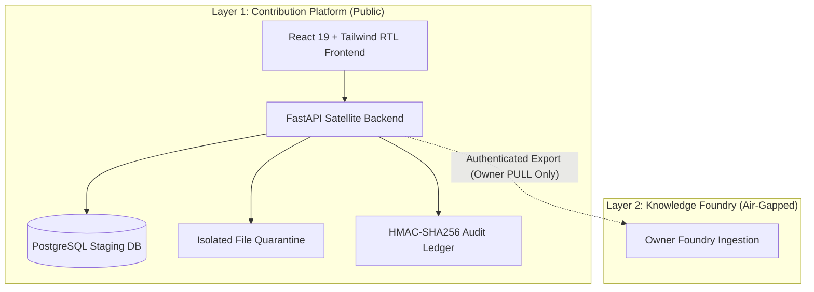

# MAHOUNN Legal Contribution Platform - Architectural Specification

## 1. Executive Summary
The MAHOUNN Legal Contribution Platform is an open, crowdsourced legal data intake and peer-review satellite service. It enables legal researchers, jurists, and contributors to submit Iranian statutes, regulations, judicial precedents, and court orders through a structured, verifiable workflow without granting any access to the proprietary MAHOUNN Core Knowledge Graph or Reasoning Engine.

## 2. Decoupled Three-Layer Ecosystem
As defined in the canonical architecture:
- **Layer 1 (This Repository): Public Contribution Platform (`contribution_service`)**
  - Standalone service containing public ingestion APIs, peer-review quorum FSM, cryptographic audit ledger, and Persian RTL frontend.
  - Interacts exclusively with its local PostgreSQL/SQLite staging database.
- **Layer 2: Private Knowledge Foundry (Owner-Controlled Environment)**
  - Air-gapped offline environment where the owner pulls validated contributions via authenticated `/internal/export` endpoints.
  - Executes proprietary semantic relation extraction, ontology evolution, and canonical graph compilation.
- **Layer 3: MAHOUN Core Production Runtime**
  - Production server executing the immutable read-only Neo4j graph replica and Ultra NLI text-grounding verifier.

## 3. High-Level Subsystems

## 4. Subsystem Details
1. **Source Validator:** Whitelist-based validation of official government and judiciary domains (`rc.majlis.ir`, `dotic.ir`, `rooznamehrasmi.ir`, `divan-edalat.ir`).
2. **Text Normalization & Enhancement:** Hazm-compatible Persian legal normalization, diacritics stripping, automated metadata extraction (articles, notes, entities).
3. **Smart Duplicate Detector:** SimHash fingerprinting and exact SHA-256 content hashing to prevent redundant submissions.
4. **Finite State Machine (FSM):** Enforces peer-review transitions (`submitted` -> `under_review` -> `approved` / `rejected`), requiring strict quorum consensus (2 reviewers for high-risk repeals).
5. **Cryptographic Audit Ledger:** Tamper-evident sequential hash chaining ensuring historical auditability.
