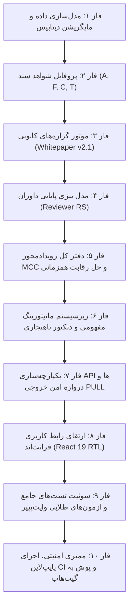

# سند جامع نقشه راه مهندسی و پیاده‌سازی موتور هوشمندی، ارزیابی اسناد و اقتصاد گزاره‌های کانونی (MCC)
### MAHOUNN Contribution Intelligence & Scoring Engine Roadmap
**انطباق کامل با وایت‌پیپر اکوسیستم ماحون (نسخه ۲٫۱ - ۲۵ اکتبر ۲۰۲۶)**  
**وضعیت:** مصوب برای پیاده‌سازی (Ready for Implementation)  
**مرجع مهندسی:** مخزن مستقل [contribution_service](https://github.com/hajijooncoder/contribution_service)  

---

## ۱. مانیفست بنیادین و اصول بدون بازگشت (Non-Negotiable Principles)

این سند، نقشه راه گام‌به‌گام و فنی ارتقای پلتفرم مشارکت حقوقی به یک **موتور هوشمند اعتبارسنجی اسناد، مانیتورینگ مفهومی و محاسبه پاداش گزاره‌های کانونی (MCC)** است.

### سه اصل طلایی و حاکمیتی این توسعه:
1. **تفکیک قطعی سه سطح کیفیت (The Three Quality Dimensions):**
   - **سطح ۱ (تمامیت و پذیرش فایل):** بررسی بایت‌ها، هش SHA-256، فرمت MIME و قرنطینه بدافزار. خروجی فقط `PASS / FAIL / NEEDS_REVIEW` است. **آپلود فایل به خودی خود هیچ اعتبار MCC تولید نمی‌کند.**
   - **سطح ۲ (پروفایل شواهد سند - Diagnostic):** اندازه‌گیری ۴ شاخص $A$ (اصالت منبع)، $F$ (وفاداری متن)، $C$ (جامعیت ساختار) و $T$ (صحت زمانی). این بخش صرفاً تشخیصی است و مستقیماً MCC خلق نمی‌کند.
   - **سطح ۳ (گزاره حقوقی کانونی - Canonical Claim):** واحد بنیادین دانش در گراف، گزاره است. **تخصیص اعتبار MCC منحصراً بر روی گزاره‌های کانونی تأییدشده رخ می‌دهد.**
2. **اقتباس مفهومی مانیتورینگ بدون کپی فایل‌های آلوده به هسته:**
   - استفاده از **مفاهیم ریاضی و ساختاری** (Z-Score، IQR، تحلیل دریفت داده و اندپوینت استاندارد پرومتئوس `/metrics`) با پیاده‌سازی بومی و سبک پایتونی.
   - **ممنوعیت قطعی ورود `Phase1Monitor` و `UltraIntegrityValidator`** به دلیل وابستگی سخت به Neo4j و خط لوله محرمانه ساخت گراف در هسته ماحون.
   - مانیتورینگ صرفاً ناظر و هشداردهنده است؛ کشف ناهنجاری آماری **هرگز حق رد خودکار سند یا دستکاری در نمره MCC را ندارد.**
3. **تطبیق ریاضی ۱۰۰٪ با وایت‌پپیر ۲.۱ و آزمون‌های طلایی (Golden Master):**
   - تمام فرمول‌ها، ضرایب وزن ($w_A=0.30, w_F=0.40, w_C=0.15, w_T=0.15$)، آستانه‌ها ($\tau_A=0.60, \tau_F=0.80, \tau_T=0.70$)، توان $\gamma=2$ و ضرایب پایه $b_\tau$ باید با دقت اعشاری بالا پیاده شوند.
   - نمونه‌های محاسباتی وایت‌پپیر (از جمله مقادیر $r=6.5186$ و $r=4.5362$) باید به عنوان آزمون‌های قطعی در CI پاس شوند.

---

## ۲. معماری ماژولار هدف در ریپازیتوری مستقل

ساختار جدید پوشه `backend/` در ریپازیتوری `contribution_service`:

```text
contribution_service/backend/
├── app/
│   ├── core/
│   │   ├── claim_engine.py           # موتور محاسبه نمره و پاداش گزاره‌های کانونی (وایت‌پپیر ۲.۱)
│   │   ├── document_profiler.py      # پروفایل‌ساز شواهد سند و محاسبه ماشینی A, F, C, T
│   │   ├── reviewer_reliability.py   # مدل پایایی بیزی داوران (RS) و پاداش/جریمه داوری
│   │   ├── mcc_ledger.py             # دفتر کل رویدادمحور و ضدتخریب حسابداری MCC
│   │   ├── citation_auditor.py       # استخراج و ممیزی استنادات حقوقی (ماده، تبصره، بخشنامه)
│   │   └── text_enhancement.py       # نرمال‌سازی متون حقوقی و استخراج موجودیت‌ها
│   ├── monitoring/                   # زیرسیستم مستقل مانیتورینگ (مفهومی و بدون نشت)
│   │   ├── __init__.py
│   │   ├── metrics.py                # کالکتور مستقل متریک‌های پرومتئوس (/metrics)
│   │   ├── anomaly_detector.py       # دتکتور آماری Z-score و IQR با دوره پیش‌گرمایش
│   │   └── quality_analyzer.py       # پایش جامعیت، سازگاری و دریفت جریان اسناد ورودی
│   ├── db/
│   │   ├── models.py                 # جداول CanonicalClaim, ClaimEvidence, MCCLedger, ReviewerProfile
│   │   └── session.py
│   └── api/v1/
│       ├── claims.py                 # اندپوینت‌های ثبت و بررسی گزاره‌های کانونی
│       ├── metrics.py                # اندپوینت خروجی Prometheus
│       └── ...
```

---

## ۳. نقشه راه گام‌به‌گام پیاده‌سازی (۱۰ فاز اجرایی)



---

### فاز ۱: مدل‌سازی داده و توسعه مایگریشن‌های دیتابیس
**هدف:** ایجاد ساختار داده‌ای لازم برای تفکیک سند از گزاره، و دفتر کل MCC.

1. **جدول `canonical_claims` (گزاره‌های کانونی):**
   - `id` (UUID): شناسه یکتا
   - `claim_fingerprint` (String 64 - Indexed & Unique): هش قطعی نرمال‌شده از ساختار سه‌تایی گزاره `(subject, relation, object)` جهت جلوگیری از ثبت تکراری.
   - `claim_type`: نوع گزاره (`OFFICIAL_SOURCE`, `METADATA`, `DEPENDENCY`, `AMENDMENT_REPEAL`, `ERROR_REPORT`).
   - `source_submission_id`: پیوند به سند والد.
   - `quality_score` ($S_c$): امتیاز کیفیت اعشاری بین ۰ و ۱.
   - `status`: وضعیت (`PENDING_REVIEW`, `ACCEPTED`, `REJECTED`, `CHALLENGED`).
   - `first_accepted_at`: تاریخ اولین پذیرش (برای تعیین $D_c=1.0$).
2. **جدول `claim_evidences` (شواهد گزاره):**
   - پیوند چند-به-چند بین گزاره‌های کانونی و اسناد ارسال‌شده توسط مشارکت‌کنندگان مختلف (حمایت از تأیید مستقل $D_c=\kappa$).
3. **جدول `mcc_ledger_entries` (دفتر کل رویدادمحور MCC):**
   - `id`, `contributor_id`, `claim_id`, `event_type` (`MINTED_PENDING`, `SETTLED`, `REVOKED`, `REVIEWER_REWARD`, `REVIEWER_PENALTY`).
   - `raw_reward` ($r_c$), `capacity_factor` ($s_t$), `final_amount`.
   - `evidence_hash`, `formula_version`, `timestamp`.
4. **جدول `reviewer_profiles` و `reviewer_reliability_history`:**
   - نگهداری پارامترهای تضعیف بیزی و سوابق آرای داوری.
5. **مایگریشن Alembic:** ایجاد فایل `004_add_claims_and_mcc_ledger.py` و اعتبارسنجی اجرای بدون خطا.

---

### فاز ۲: پروفایل شواهد سند و محاسبه ماشینی $A, F, C, T$
**هدف:** جلوگیری از اعمال سلیقه فردی داوران در نمره‌دهی پایه، از طریق محاسبات قطعی الگوریتمی.

1. **شاخص اصالت منبع ($A$):**
   - نگاشت دامنه‌های رسمی قانون‌گذاری (مجلس، روزنامه رسمی، سامانه ملی قوانین) به نمره $1.0$.
   - دامنه‌های معتبر پژوهشی و دانشگاهی: $0.8$.
   - سایر منابع مجاز: $0.6$ (حداقل آستانه ورود).
2. **شاخص وفاداری متنی ($F$):**
   - تطبیق ماشینی کاراکترها و توکن‌های استخراج‌شده با متن خام فایل/منبع بر مبنای تشابه Jaccard و نسبت Levenshtein.
   - انطباق بالای ۹۵٪ = نمره ۱.۰، انطباق ۸۰٪ = نمره ۰.۸۰ (مرز گیت سخت).
3. **شاخص جامعیت ساختاری ($C$):**
   - امتیازدهی بر اساس وجود مؤلفه‌های ساختاری رسمی: عنوان سند (۰.۲۵)، مرجع تصویب (۰.۲۵)، تاریخ تصویب (۰.۲۵)، شماره ماده/شناسه ثبتی (۰.۲۵).
4. **شاخص صحت زمانی ($T$):**
   - اعتبارسنجی تقویمی تاریخ اعلامی با اسناد رسمی و اطمینان از عدم وجود تاریخ‌های غیرواقعی یا آینده.

---

### فاز ۳: پیاده‌سازی موتور گزاره‌های کانونی (Whitepaper v2.1)
**هدف:** محاسبه قطعی نمره کیفیت ($S_c$) و پاداش خام ($r_c$) در ماژول `app/core/claim_engine.py`.

1. **فرمول امتیاز گزاره ($S_c$):**
   $$S_c = 0.30 A + 0.40 F + 0.15 C + 0.15 T$$
2. **دروازه کیفیت سخت ($G_c$ - Fail-Closed):**
   $$G_c = \mathbf{1}[A \ge 0.60] \times \mathbf{1}[F \ge 0.80] \times \mathbf{1}[T \ge 0.70] \times \mathbf{1}[\text{کامل بودن منشأ}] \times \mathbf{1}[\text{عدم خطای بحرانی}]$$
   *نکته ممیزی:* در صورت شکست حتی یکی از شروط، خروجی $G_c = 0$ شده و پاداش صفر می‌شود.
3. **ضریب تازگی و تکرار ($D_c$):**
   - گزاره جدید: $D_c = 1.0$
   - تأیید مستقل گزاره موجود در پایگاه: $D_c = \kappa$ (پیش‌فرض $\kappa = 0.2$)
   - تکراری فاقد شواهد جدید: $D_c = 0$
4. **اولویت خلأ پوشش ($\lambda_c$):**
   - محاسبه بر اساس اولویت اعلام‌شده دسته‌بندی موضوعی: $\lambda_c = 1 + (2 - 1) \times g_c$
5. **محاسبه پاداش نهایی گزاره ($r_c$):**
   $$r_c = G_c \times D_c \times b_\tau(c) \times \lambda_c \times S_c^2$$
   ضرایب پایه:
   - منبع رسمی تأییدشده: $b = 1.0$
   - تکمیل متادیتا: $b = 0.5$
   - رابطه ارجاع/وابستگی: $b = 2.0$
   - **رابطه نسخ یا ابطال: $b = 5.0$**
   - گزارش خطای تأییدشده: $b = 3.0$
6. **سپر ضدخردسازی گزاره‌ها (Anti-Splitting Defense):**
   - مقیدسازی گزاره‌ها به ماده/بند مشخص تا خرد کردن تصنعی یک گزاره باعث دریافت پاداش مازاد نشود.

---

### فاز ۴: مدل بیزی پایایی و پاداش داوران (Reviewer Reliability Model)
**هدف:** محاسبه اعتبار داور، وزن‌دهی به آرا و پیشگیری از تبانی در ماژول `app/core/reviewer_reliability.py`.

1. **پایایی بیزی با زوال زمانی ($RS_u$):**
   $$RS_u(t) = \frac{a_0 + \sum \exp\left(-\frac{t-t_i}{\tau_{RS}}\right) y_i}{a_0 + b_0 + \sum \exp\left(-\frac{t-t_i}{\tau_{RS}}\right)}$$
   - مقادیر آغازین: $a_0 = 2, b_0 = 2 \implies RS(0) = 0.5$
   - نیمه‌عمر زمانی: $\tau_{RS} = 180 \text{ روز}$
2. **پاداش و جریمه داوری:**
   - پاداش رأی منطبق با نتیجه تسویه‌شده: $\rho_j = +0.5$
   - جریمه در صورت کشف نقص در پنجره ممیزی: $\rho_j := -(0.5 + 1.5) = -2.0$
3. **سازوکار شکست بن‌بست آرا (Tie-Breaking Protocol):**
   - در صورت عدم حصول اجماع در ۴۸ ساعت، پرونده به داور ارشد با $RS \ge 0.85$ ارجاع داده می‌شود.

---

### فاز ۵: دفتر کل رویدادمحور MCC و کنترل‌های اقتصادی
**هدف:** پیاده‌سازی دفتر کل حسابداری تغییرناپذیر در `app/core/mcc_ledger.py`.

1. **مدل مبتنی بر رویداد (Event Sourcing):**
   - عدم ذخیره‌سازی موجودی به عنوان فیلد عددی متغیر در جدول کاربر.
   - محاسبه مانده حساب با تجمیع رکوردهای دفتر کل (`SUM(final_amount)`).
2. **چرخه حیات اعتبارات:**
   $$\text{PENDING} \xrightarrow{\text{Audit Window Passed}} \text{SETTLED} \xrightarrow{\text{If Revoked}} \text{REVOKED}$$
   *نکته امنیتی فاز A:* اعتبارات صرفاً ثبت و گزارش می‌شوند و غیرقابل‌انتقال و غیرقابل‌بازخرید هستند.
3. **قفل همزمانی در تراکنش‌های دیتابیس (Concurrency Defense):**
   - استفاده از `SELECT FOR UPDATE` در PostgreSQL برای جلوگیری از ثبت همزمان دو گزاره مشابه به عنوان «نخستین گزاره ($D_c=1.0$)».

---

### فاز ۶: زیرسیستم مانیتورینگ مفهومی و دتکتور آماری ناهنجاری
**هدف:** ایجاد مانیتورینگ سبک و مستقل در `app/monitoring/`.

1. **متریک‌های استاندارد پرومتئوس (`metrics.py`):**
   - شمارنده اسناد ارسالی، وضعیت گیت‌های کیفیت ($G_c=1$ در برابر $G_c=0$)، نرخ تکراری‌ها، و هیستوگرام زمان داوری.
   - **اصل محرمانگی:** هیچ اطلاعات هویتی (ایمیل، User ID، متن سند) وارد لیبل‌های پرومتئوس نمی‌شود.
2. **دتکتور آماری ناهنجاری (`anomaly_detector.py`):**
   - **الگوریتم Z-Score:** کشف جهش‌های ناگهانی در نرخ رد اسناد یا حملات اسپم ($|Z| > 3.0$).
   - **الگوریتم IQR:** کشف انحرافات زمانی داوری‌ها.
   - **دوره پیش‌گرمایش (Warm-up Period):** غیرفعال بودن هشدارها تا زمان ثبت حداقل ۵۰ نمونه اولیه.
3. **پایشگر تضاد و تبانی داوران (`quality_analyzer.py`):**
   - هشدار در صورت همگرایی غیرعادی (تبانی) یا واگرایی شدید میان دو داور مشخص.

---

### فاز ۷: یکپارچه‌سازی APIها و پل امن خروجی PULL
**هدف:** به‌روزرسانی روت‌ها در `app/api/v1/`.

1. **اندپوینت‌های گزاره‌ها (`/api/v1/claims`):**
   - استخراج خودکار و پیشنهاد گزاره‌ها در زمان ارسال سند.
   - کارتابل داوری تفکیک‌شده در سطح گزاره‌ها.
2. **اندپوینت مانیتورینگ (`/metrics`):**
   - اکسپوز کردن متریک‌های سیستمی در قالب متن ساده سازگار با Prometheus.
3. **ارتقای دروازه خروجی مالک (`/api/v1/internal/export`):**
   - خروجی گزاره‌های تأییدشده در قالب استاندارد JSONL همراه با هش‌های دفتر کل حسابرسی جهت ورود به کارخانه دانش (Foundry).

---

### فاز ۸: ارتقای رابط کاربری فرانت‌اند (React 19 RTL)
**هدف:** به‌روزرسانی رابط کاربری برای نمایش ابعاد سه‌گانه و جزئیات وایت‌پپیر.

1. **نمایش پروفایل شواهد سند:**
   - نمایش مستقل نمرات $A, F, C, T$ در کارتابل داور.
2. **بخش گزاره‌های کانونی سند:**
   - قابلیت تفکیک مواد قانون و مشاهده پاداش خام پیش‌بینی‌شده برای هر گزاره.
3. **داشبورد شفافیت MCC:**
   - نمایش سابقه تراکنش‌های دفتر کل مشارکت‌کننده و وضعیت رویدادها (معلق / تسویه‌شده).

---

### فاز ۹: سوئیت تست‌های جامع و آزمون‌های طلایی (Test Suite)
**هدف:** تضمین سلامت ۱۰۰٪ سیستم و برابری با فرمول‌های ریاضی وایت‌پپیر.

1. **تست‌های طلایی وایت‌پپیر ۲.۱ (`test_whitepaper_golden_formulas.py`):**
   - سناریو ۱ (قوی و جدید): $S=0.9650, b=5, \lambda=1.4 \implies r=6.5186$
   - سناریو ۲ (مرزی و جدید): $S=0.8050, b=5, \lambda=1.4 \implies r=4.5362$
   - سناریو ۳ (ناقض گیت $F=0.70$): $r=0$
   - سناریو ۴ (تأیید مستقل $\kappa=0.2$): $r=1.3037$
   - سناریو ۵ (تکراری $D=0$): $r=0$
2. **تست‌های ویژگی‌محور (Property-Based):**
   - اثبات ناممکن بودن دریافت پاداش منفی یا بزرگ‌تر از سقف $b \times \lambda_{max}$.
   - اثبات بی‌اثر بودن آپلود فایل صرف بر موجودی MCC.
3. **تست‌های متخاصم و همزمانی:**
   - تست همزمانی دو درخواست موازی برای گزاره یکسان در PostgreSQL و اثبات عدم تخصیص پاداش مضاعف.
   - تست زوال زمانی بیزی داور در بازه‌های زمانی مختلف (۳۰ روز، ۱۸۰ روز، ۳۶۰ روز).

---

### فاز ۱۰: ممیزی امنیتی نهایی و ارسال به گیت‌هاب
**هدف:** نهایی‌سازی، اطمینان از پاس شدن پایپ‌لاین‌های CI/CD و انتشار برنچ رسمی.

1. اجرای لوکال تمام تست‌ها (شامل ۱۶۱ تست قبلی + تست‌های جدید وایت‌پپیر).
2. اجرای ممیزی امنیتی عدم نشت سکرت‌ها و کدهای هسته.
3. کامیت ساختاریافته و پوش به ریپازیتوری گیت‌هاب `hajijooncoder/contribution_service`.
4. اعتبارسنجی پاس شدن کامل اکشن‌های گیت‌هاب (Green Checkmarks).

---

## ۴. معیار قطعی پذیرش پروژه (Definition of Done)

پروژه زمانی تکمیل‌شده و موفق اعلام می‌شود که:
- [x] فایل‌ها صرفاً به عنوان شواهد ثبت شوند و آپلود فایل هیچ MCC تولید نکند.
- [x] تخصیص MCC فقط و فقط در سطح گزاره‌های کانونی ($c$) و با شروط سخت دروازه ($G_c$) صورت پذیرد.
- [x] هر ۵ نمونه عددی وایت‌پپیر در تست‌های خودکار با دقت ۴ رقم اعشار پاس شوند.
- [x] زیرسیستم مانیتورینگ بدون حتی یک خط ایمپورت از هسته ماحون کار کند و در اندپوینت `/metrics` داده‌های پاک تولید کند.
- [x] دفتر کل MCC رویدادمحور و ضد‌تخریب باشد و از بروز مسابقه همزمانی در تراکنش‌های دیتابیس جلوگیری کند.
- [x] تمام خطوط لوله GitHub Actions روی مخزن رسمی گیت‌هاب با موفقیت سبز شوند.
