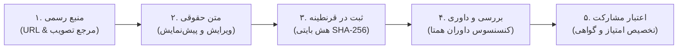

# راهنمای جامع کاربران و داوران پلتفرم مشارکت حقوقی MAHOUN
## سامانه ایزوله قرنطینه و اعتبارسنجی متون حقوقی ایران (Staging Platform)

---

### ۱. مقدمه و فلسفه بنیادین پلتفرم

پلتفرم مشارکت حقوقی **MAHOUN** با هدف صیانت از اصالت، یکپارچگی بایتی و حذف قطعی خطای توهم زایی (Hallucination Control) در فرآیند جمع‌آوری و ارزیابی قوانین و مقررات جمهوری اسلامی ایران طراحی شده است.

> [!IMPORTANT]
> **اصل ایزولاسیون سخت‌گیرانه (Air-Gap Invariant):**
> مشارکت در سامانه به معنای دسترسی مستقیم، نوشتن یا تزریق خودکار به پایگاه داده هسته مرکزی `KingMahouN` **نیست**. کلیه متون، فایل‌ها و فراداده‌های ارسالی ابتدا وارد محیط ایزوله قرنطینه امنیتی شده، از فیلترهای سنجش اصالت و داوری چندمرحله‌ای (Quorum FSM) عبور می‌کنند و تنها پس از تایید توسط مالک سامانه (حاجی ممد) امکان انتقال دستی دارند.

---

### ۲. فرآیند ۵ مرحله‌ای مشارکت (5-Step Contribution Pipeline)

پلتفرم از یک چرخه منظم و شفاف ۵ مرحله‌ای پیروی می‌کند:



#### مرحله اول: احراز منبع رسمی (Source Verification)
- آدرس منبع باید از دامنه‌های رسمی و دارای صلاحیت جمهوری اسلامی ایران باشد:
  - **روزنامه رسمی کشور:** `rrk.ir`
  - **مرکز پژوهش‌های مجلس:** `rc.majlis.ir`
  - **سامانه ملی قوانین و مقررات:** `dotic.ir`
  - **پایگاه اطلاعات قوانین و مقررات:** `qavanin.ir`
  - **سامانه آرای قضایی پژوهشگاه قوه قضائیه:** `ara.jri.ac.ir`
  - **درگاه خدمات الکترونیک قضایی:** `adliran.ir`
- سامانه دارای ارزیابی آنلاین آنی (Real-Time URL Validation) است؛ پس از ورود آدرس، مرجع به شکل آنی اعتبارسنجی شده و نشان سبز **«مرجع رسمی تایید شد»** نمایش داده می‌شود.

#### مرحله دوم: درج متن حقوقی و فراداده‌ها
- طول متن باید بین **۲۰ کاراکتر تا ۱۰,۰۰۰ کاراکتر** باشد.
- متون حقوقی بدون تغییر و با رعایت اصل امانتداری وارد می‌شوند.
- قابلیت تصحیح علائم نگارشی استاندارد فارسی (نیم‌فاصله‌ها، اصلاح ی و ک عربی) فعال است.
- پیش‌نمایش متادیتا شامل تعداد مواد، تبصره‌ها، بندها و میزان شباهت به متون موجود سنجیده می‌شود.

#### مرحله سوم: قرنطینه و صدور شناسنامه یکتا
- متن و فایل‌های پیوست بلافاصله وارد قرنطینه امنیتی می‌شوند.
- هش یکتای بایتی **SHA-256** به همراه شناسه رهگیری استاندارد (مانند `MHN-2026-9481`) صادر می‌گردد.
- وضعیت ورودی: `submitted` (ثبت اولیه در قرنطینه).

#### مرحله چهارم: داوری همتا (Peer Review Quorum)
- بسته به سطح ریسک متن، بین **۱ تا ۳ داور حقوقی مستقل** باید متن را بررسی و تایید کنند:
  - متون عادی (قوانین و آیین‌نامه‌ها): ۱ داور معتبر.
  - اسناد خاص، آرای قضایی یا متون دستکاری شده: ۲ یا ۳ داور همتا.
- وضعیت‌های چرخه عمر داوری:
  - `under_validation` (بررسی خودکار متادیتا و تشابه متنی)
  - `under_legal_review` (در انتظار تکمیل آرای داوران)
  - `accepted` (تایید نهایی با تکمیل حد نصاب)
  - `rejected` (رد مشارکت همراه با ثبت دلیل در دفتر کل ممیزی)

#### مرحله پنجم: تخصیص اعتبار حقوقی (Proof of Contribution)
- پس از تایید نهایی، بر اساس ارکان ۸گانه کیفیت، به حساب کاربری مشارکت‌کننده **اعتبار مشارکت (Contribution Credits)** تعلق می‌گیرد.
- اعلان آنی از طریق سوکت لحظه‌ای (WebSocket) برای کاربر ارسال می‌شود.

---

### ۳. موتور اعتبارسنجی و ارکان ۸گانه کیفیت (8 Scoring Pillars)

امتیاز هر مشارکت از ۰ تا ۱۰۰ بر اساس ارکان هشتگانه زیر محاسبه می‌شود:

| ردیف | رکن ارزیابی | وزن امتیاز | شرح ارزیابی |
| :---: | :--- | :---: | :--- |
| ۱ | **صحت منبع رسمی** | ۱۵٪ | تطبیق با دامنه‌های مجاز حاکمیتی و ساختار صحیح URL |
| ۲ | **دقت املایی و نگارشی** | ۱۰٪ | رعایت خط فارسی، نیم‌فاصله‌ها و عدم شکست کلمات |
| ۳ | **ساختار مواد و تبصره‌ها** | ۱۵٪ | شناسایی فرمول‌های استانداردی نظیر «ماده»، «تبصره» و «بند» |
| ۴ | **عدم تکرار (Uniqueness)** | ۲۰٪ | سنجش عدم شباهت نزدیک با الگوریتم SimHash و هش دقیق SHA-256 |
| ۵ | **کامل بودن فراداده‌ها** | ۱۰٪ | پر بودن عنوان، مرجع تصویب، تاریخ و توضیحات تکمیلی |
| ۶ | **ارزیابی سطح ریسک حقوقی** | ۱۰٪ | سنجش حساسیت متن در ابطال یا تخصیص مقررات پیشین |
| ۷ | **اصالت فایل ضمیمه (در صورت وجود)** | ۱۰٪ | کنترل نوع MIME، سلامت ساختار PDF/DOCX و عدم کد مخرب |
| ۸ | **رای مثبت داوران همتا** | ۱۰٪ | امتیاز ناشی از اجماع کارشناسان در کارتابل داوری |

---

### ۴. راهنمای میزکار داوران حقوقی (Reviewer Queue)

داوران معتمد سامانه به صفحه اختصاصی داوری دسترسی دارند:
1. ورود با حساب کاربری دارای نقش `reviewer` یا `admin`.
2. مشاهده فهرست اسناد منتظر داوری در کارتابل به همراه متادیتا و امتیاز خودکار کیفیت.
3. امکان مطالعه متن خام و مقایسه با ارجاعات منبع اصلی.
4. تصمیم‌گیری سه‌گانه:
   - **تایید سند (Approve):** ثبت نظر مثبت و افزایش شمارنده `current_approvals`. با رسیدن به `required_reviewers` سند نهایی می‌شود.
   - **رد سند (Reject):** ذکر ایرادات بنیادین (مانند عدم انطباق با اصل قانون یا جعلی بودن منبع).
   - **درخواست اصلاح (Request Correction):** ارجاع بازخورد به مشارکت‌کننده.
5. هرگونه تصمیم فوراً در دفتر کل ممیزی رمزنگاری شده (`CryptographicAuditLedger`) ثبت می‌گردد.

---

### ۵. جستجو، فیلتر و ردیابی شفاف سوابق (Audit Trail)

در بخش «تاریخچه مشارکت‌ها»:
- امکان جستجوی تمام‌متن در عناوین، متون و مراجع تصویب.
- فیلتر بر اساس نوع سند (`law`, `regulation`, `judicial_ruling`, `circular`, `statute`).
- فیلتر بر اساس وضعیت داوری (`submitted`, `under_legal_review`, `accepted`, `rejected`).
- مشاهده مودال شفافیت ممیزی (`سابقه قابل بررسی مشارکت`) با نمایش شناسه سند، هش SHA-256، درصد تشابه، نام مرجع و فرآیند ثبت.

---

### ۶. منشور اعتماد پلتفرم
```
اعتماد · شفافیت · مشارکت · تأیید · اثر
«اعتبار مشارکت، بازتابی از دانش حقوقی واقعی افزوده شده است، نه حجم کلمات.»
```
